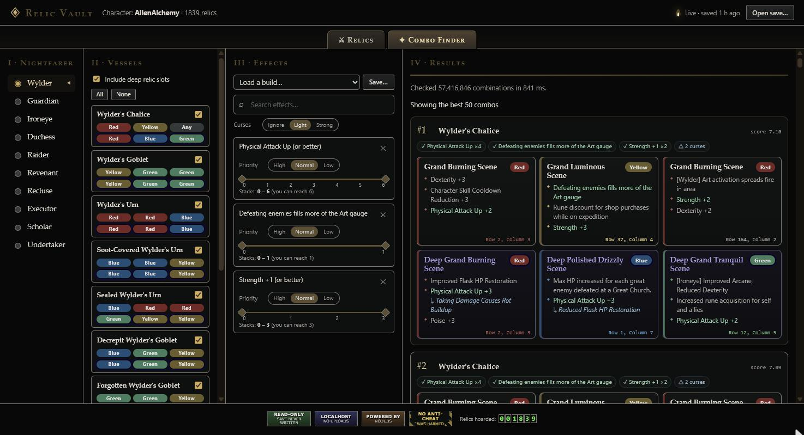
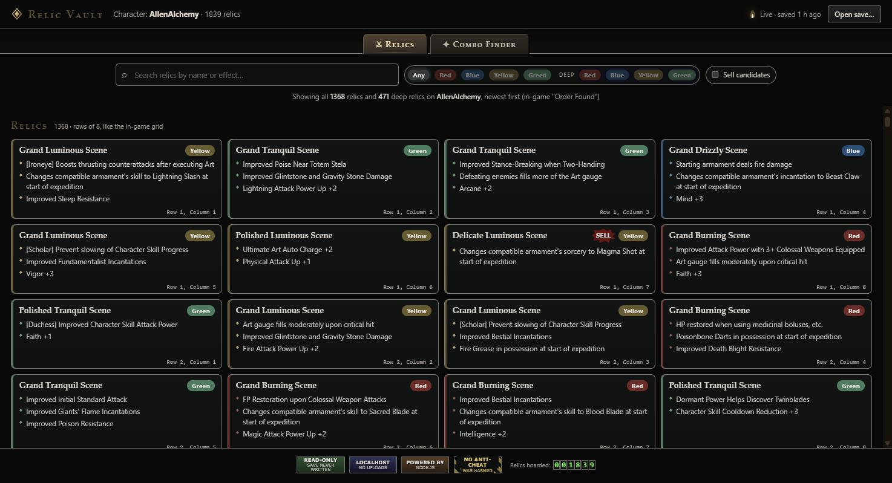

# Relic Vault

A local web app for **Elden Ring Nightreign** relics. It reads your save file (read-only), lets you browse
and search every relic, flags ones you can sell, and finds the best vessel + relic loadout for the effects
you want.



## Run

Requires [Node.js](https://nodejs.org) 20+. No install step.

```
node server.mjs
```

On Windows you can double-click `Relic Vault.cmd` instead. It opens `http://localhost:5177` and loads your
save from `%APPDATA%\Nightreign\<SteamID>\NR0000.sl2`. The page updates on its own whenever the game saves.
You can also open or drag in any `.sl2` file.

Modded saves work too: `.co2` alt saves in the same folder (e.g. More Map Variations via ModEngine3) show up in
a save picker next to the normal one. `python -I scripts/extract-mmv-names.py` refreshes the names of effects
only MMV has (`public/data/mmv-names.json`); those are marked "(MMV)".

## Is it safe?

Yes. It never touches the game process or its memory, so Easy Anti-Cheat has nothing to detect. The save
file is only ever read, never written or locked, and the game keeps saving normally while it runs. Nothing
leaves your PC: the server only answers on localhost.

## Features

- Search all relics by name or effect, and filter by color or deep/normal.
- Relics are sorted like the in-game "Order Found", with the row and column where each one appears.
- Duplicate and outclassed relics are flagged, with a side-by-side "keep this one" comparison.
- NEW badges mark relics gained since your last visit.
- **Combo Finder**: pick a Nightfarer, then one of their builds, to get the 50 best loadouts across all of
  their vessels.
  - Builds can be created, renamed, duplicated and deleted, and every edit saves on its own.
  - Wanted effects are **Required** or ranked 1 to 12. Stackable effects also get a stack range.
  - Avoided effects (usually curses) are **Blocked** or avoided with a rank 1 to 12, plus a penalty for
    curses that aren't listed.
  - Goal checklist on each result.



## Troubleshooting

If the Combo Finder says "Search failed" or "Ran without background workers", click **Copy debug report** and
paste it into a [GitHub issue](https://github.com/tonydavis629/nightreign-relic-vault/issues), along with any
`404` or `500` lines from the terminal window running the server. The report has your browser, the search size
and the worker error; it contains no save data.

## Development

```
npm test                 # parser, sell detection, combo search, read-only guarantees
npm run update-data      # refresh item/effect data after a game patch
```

## Credits

Save-format research and game data come from
[RelicBrowser](https://github.com/metinc/nightreign-relic-browser) by Metin Çelik (MIT, see
`UPSTREAM-LICENSE`). Relic Vault is a local rewrite: the combo search is ported from its Rust engine and
diff-tested against it, with several bugs fixed.

Not affiliated with FromSoftware or Bandai Namco.
